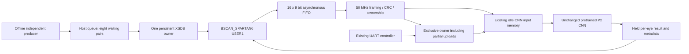

# Physically verified JTAG streaming CNN

The opt-in JTAG RAW variant completes **30.336 pairs/s versus 7.519 pairs/s** for
the unchanged UART baseline: **4.035x** in two matched 32-pair trials per mode.
All 64 pairs per mode completed, with no drops or integer mismatches. This is a
transport improvement; the P2 kernel remains **735478 cycles / 14.70956 ms per
pair** at 50 MHz. The canonical UART image stays the default and was restored.
No camera, new adapter, wiring change, flash programming or firmware update was used.

## Architecture



There is no secondary full image RAM, temporal compression or inter-frame input/
compute overlap. Each eye runs the complete CNN. Only one eye request is active.
The host pairs results only after checking the actual returned frame ID, eye ID,
capture timestamp and sequence. Capture timestamps are controlled offline source
schedules, never measured video timestamps.

The isolated variant builder patches copies of the top and command controller.
The original canonical RTL/ROM/pin/BIT files remain byte-identical. The new
controller output exposes an incomplete UART upload, so JTAG cannot steal memory
between legacy upload packets. UART commands wait during JTAG ownership; a system
lock remains held if TAP reset occurs while the CNN is busy. Input writes are
also gated against active computation. These policies have full-top pin-level UART
simulation and physical partial-upload/held-result tests.

The receiver may write a partial tensor into idle input memory before final CRC
validation. This is **not an atomic memory commit**. Invalid length, CRC, sequence,
model or eye identity prevents inference; the next valid request replaces all
3072 bytes. A paused or abandoned scan requires bounded host error handling and
explicit recovery; no previous result is substituted. UART partial uploads must
finish or be explicitly aborted before JTAG can acquire ownership.

## Connected hardware and technical references

Discovery found one Xilinx Platform Cable USB, DLC9LP, serial `20250619a8d001`,
USB `03FD:0008`, and one `xc6slx9`, IDCODE `24001093`, six IR bits. The local
hw_server used `xilinx-pcusb`. Available TCK settings were 0.75/1.5/3/6/12 MHz;
initial TCK was 1.5 MHz. All five settings passed physical USER1 payload tests.
The CNN benchmark selected **12 MHz**. These are XSDB settings/readbacks, not an
external oscilloscope measurement.

Installed XSDB 2023.2 supports binary IR/DR shifts, TDO capture and scan batching.
It has no `jtag cables` command; level-zero `jtag targets` enumerates cables.
IDCODE-only command timing was recorded separately as
`JTAG_COMMAND_BENCHMARK_ONLY`, never application payload delivery.

References: [UG615 14.7, BSCAN_SPARTAN6](https://docs.amd.com/api/khub/documents/vQtlI_b91BnfgS4vomaVZg/content),
[Xilinx UG380](https://0x04.net/~mwk/xidocs/ug/ug380.pdf), and the
[XSDB sequence reference](https://docs.amd.com/r/2022.1-English/ug1400-vitis-embedded/jtag-sequence).
USER1/2/3/4 use opcodes 0x02/0x03/0x1a/0x1b and require configured user logic.
The original application has no USER data channel.

## CDC and timing

The primitive has the full ISE port list. Buffered TCK clocks scan logic gated by
SEL/CAPTURE/SHIFT/UPDATE; using TCK allows UPDATE handling when gated DRCK has no
edge. Neither clock is assumed to run continuously. Byte and boundary tokens
cross a 16x9 distributed FIFO with Gray pointers and two-stage synchronizers.
Reset asserts in both domains; release is synchronized separately. Overflow is
sticky and rejected. Gray crossing data paths are limited to 20 ns.

The reply is a one-credit bundled-data mailbox: the system holds it stable and
an ACK toggle crosses two scan-clock registers before capture. Its data paths
are limited to 60 ns; synchronous scan paths retain the 83.333 ns period
constraint. Only first-stage single-bit ACK/overflow synchronization paths are
excluded from synchronous phase analysis. The board clock remains 20 ns.

Five asynchronous ratios, paused TCK, FIFO overflow/reset, partial scans and
byte order passed simulation. A separate full-top test drives real UART bytes
while emulating JTAG ownership and CNN busy, including TAP-reset lock retention.

## Protocol

The probe image identifies itself as `JTG1`, USERCODE `4A544731`. It physically
verified 150 payload transactions at sizes 32/256/1024/3072/6144, three trials
with full TDO capture and three without, at each supported TCK rate. Its 16-byte
reply/prefix and one-bit delayed echo are specified in the probe RTL.

The CNN image identifies itself as **JTN1**, USERCODE **4A544E31**. Each DR request
contains 41 zero prefix bytes, little-endian `<BBIH>` (version, command, uint32
sequence, uint16 payload length), payload, CRC16/CCITT-FALSE little endian and
one zero tail byte. Command 2 uploads and infers one eye. Its 3089-byte payload is
`<IQBI>` (frame ID, uint64 capture ns, eye 0/1, model fingerprint `4daa1000`) plus
3072 exact CHW BGR bytes. Each upload shifts **3141 bytes** in one operation.
Bits within each byte shift least-significant first.

A zero-filled 41-byte scan polls the held reply without opening another request.
Reply format `<4sIHHBBHiiIIQB>` contains signature, sequence, request length,
computed request CRC, status, version, accepted count, two native INT32 logits,
cycle count, frame ID, capture ns and eye ID. Native logits remain CLOSED, OPEN;
the host maps once to canonical OPEN, CLOSED. Sequence acceptance wraps modulo
2^32 independently of frame identity. The host permits one outstanding eye and
emits ordered pair outcomes; bounded timeout/abort paths emit explicit terminal
MISSING/ERROR records, including queued and rejected frames.

Statuses are OK, CRC error, invalid length, invalid sequence, overflow, partial
scan, version mismatch, unknown command, BUSY and model mismatch. Boot/reset uses
status 9 with no accepted request identity. Errors preserve sequence credit.
The reply echoes the request CRC but has **no independent whole-response CRC**;
signature, sequence, frame/eye/time, request CRC and expected cycle count are
checked. Full numerical tests found zero output mismatches; arbitrary future TDO
bit corruption is not claimed to be fully detected by a response checksum.

## Physical results

CPU reference forward passes were computed outside timed hardware requests.
All modes use identical registered static CEW and deterministic synthetic inputs.

| Metric, two trials / 64 completed pairs each | UART A | JTAG full capture B | JTAG result-only capture C |
|---|---:|---:|---:|
| Clock/link setting | 1 Mbaud 8N1 | 12 MHz TCK | 12 MHz TCK |
| Completed pairs/s | 7.519 | 15.087 | **30.336** |
| Upload mean ms/pair | 106.536 | 47.056 | **11.644** |
| Pair request RTT mean ms | 132.862 | 66.200 | **32.874** |
| RTT p95 per trial ms | 138.476 / 140.573 | 77.333 / 66.947 | 35.599 / 34.792 |
| Pair CNN cycles | 735478 | 735478 | 735478 |
| Integer mismatches / dropped pairs | 0 / 0 | 0 / 0 | 0 / 0 |
| Measured transfer accounting | 6388 UART TX+RX bytes/pair | 6682.391 DR bytes/pair | 6727.234 DR bytes/pair |

DR byte counts include request metadata and dummy TDI bytes used to clock result
polls. TDO is simultaneous with TDI; it must not be added as another wire-time
stream. TAP transitions and programming are excluded from these byte counts.
Polling time includes waiting for remaining CNN execution, not just result bits.

At 12 MHz, the separate 6144-byte probe measured 9.845 ms input upload without
full capture and 13.648 ms including its ACK polling. Full capture cost 42.627 ms
for the same upload. XSDB execution accounted for 9.009/41.532 ms respectively;
Python/Tcl formatting alone does not explain the capture penalty.

Fresh complete CEW comparison: **4846 eyes, zero integer-logit mismatches**, all
four folders, 90.512 s including reference checking and logging. This is reused
static numerical-equivalence data, not a new independent recognition-accuracy
evaluation. Small synthetic/CEW goldens and physical CRC/truncation/duplicate/
gap/model/partial-UART/reset recovery tests also passed.

Independent source schedules at 10/25/30 Hz each completed every JTAG input in
two 10-second trials. At 50/60 Hz, overload was explicit. A separate **30-second
50 Hz** schedule generated 1500 pairs: **944 accepted/completed, 556 rejected,
zero missing**, max waiting queue 8, mean queue 7.519. Including drain it lasted
30.303 s at 31.152 completed pairs/s; end-to-end p95 was 308.343 ms. Results stayed
ordered across frame and packet-counter wrap. **Sustained 50 Hz failed.**

The dominant remaining costs are the unchanged 14.71 ms kernel plus JTAG USB/
XSDB execution and result polling. No transfer/compute-overlap configuration is
claimed. A failed 50 Hz target does not negate the matched measured speedup.

## Resource and verification gates

| Post-route metric | Canonical UART | JTAG CNN |
|---|---:|---:|
| Slices | 1318 / 1430 | **1385 / 1430** |
| LUTs / registers | 4204 / 2745 | **5228 / 3803** |
| DSP / BRAM18 / BRAM9 | 10 / 29 / 0 | **10 / 29 / 0** |
| Minimum system period | 19.431 ns | **19.425 ns** |
| 50 MHz setup slack | +0.569 ns | **+0.575 ns** |
| Fmax | 51.464 MHz | **51.480 MHz** |

The final source generator reproduces every routed RTL/ROM/constraint/build Tcl
file byte-for-byte. The tested JTAG BIT SHA256 is
`fe4fa3a54cad78b37398b6bfc3c0d4fcb8fe9221c0afda823a2e50ec88c947b6`.
The model SHA256 remains
`4daa100034482525a26c9afb9297c16580a531189e66e3d2b2ac7d32becfd593`.
Hardware access, USER transport, resource fit, timing, exact correctness and
measured throughput gates pass. The independent 50 Hz gate fails.

## Reproduction and rollback

Use the existing Python 3.11 environment, Icarus 13.0 layout and ISE 14.7. Build
and regressions are offline. Physical benchmarking additionally needs the
existing hw_server/cable and registered CEW manifest; it never downloads input
data or opens a camera. Prepare a verified canonical build/rollback first.

```powershell
.\run.cmd build
assets/runtime/Scripts/python.exe -B research_ext/jtag_evaluation.py build-cnn assets/runs/jtag_NEW/cnn
assets/runtime/Scripts/python.exe -B research_ext/jtag_evaluation.py simulate-cnn assets/runs/jtag_NEW/simulation
.\test_all.bat
# Explicit volatile programming, physical tests, and verified same-session rollback:
assets/runtime/Scripts/python.exe -B research_ext/jtag_benchmark.py --program-cnn --build assets/runs/jtag_NEW/cnn --output assets/runs/jtag_NEW/physical
# Read existing results only; safe with the board disconnected:
assets/runtime/Scripts/python.exe -B research_ext/jtag_benchmark.py --report-only --build assets/runs/jtag_NEW/cnn --output assets/runs/jtag_NEW/physical
```

The explicit programming command verifies target ID, source hashes, pinned ROMs,
simulation, all timing constraints, BIT hash and prepared rollback. It plays only
ISE iMPACT-generated SVF. One persistent XSDB owner retains the selected target
across programming and scans, then restores AEEE and verifies IDCODE before
closing. No process is launched per eye and no silent UART fallback exists.
Volatile configuration does not survive power loss.

Early prototype fresh-session enumeration/rollback guards stopped before unsafe
programming; those failures and positive-ID recovery logs remain intact. The
final CNN sessions completed same-session rollback and UART golden checks. The
board was subsequently disconnected at the user's request; remaining work was
offline. Canonical UART and prior micro-batch files/results are preserved.

Raw local-only evidence is under `assets/runs/jtag_20261106_01/`: discovery,
command benchmark, isolated probe, co-residency gate, `cnn_candidate_03`,
`cnn_physical_01` (JSON/CSV/HTML/ordered traces/full CEW), `cnn_robustness_01`,
source reproduction, simulations and regression logs. Datasets, BIT/SVF and tools
are not source-release artifacts. The optional Python-below-80% target is not
claimed; only genuinely used RTL and tests were added.
