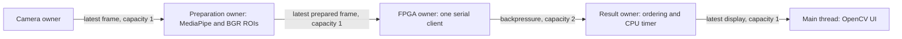

# Repository scope and dependency map

## File classification

| Classification | Files/subsystems | Decision |
|---|---|---|
| CORE | `python/pretrained_eye.py`, `pretrained_verify.py`, `fpga_host.py`, `capture.py`, `live_pipeline.py`, `experiment.py`, `blink_timing.py`, `eye_state.py`, `ocular_metrics.py`, `app.py` | Retain current working behavior |
| CORE | `fpga/rtl/omz_cnn.v`, `eye_top.v`, `command_controller.v`, UART/packet/timing/display modules, `board_pins.ucf` | Retain arithmetic, pins, clocks and wire protocol |
| CORE | `fpga/generated/omz_*`, original ONNX and license | Retain required synthesis inputs and deterministic exporter |
| SUPPORT | `research_ext/test_*.py`, benches, protocol, `python/system_sim.py`, build/program Tcl/CMD files, canonical XISE, launchers, requirements and docs | Retain regression/reproducibility chain |
| OPTIONAL_RESEARCH | `python/encoders/`, `integer_model.py`, `research_model.py`, `research.py`, `data_tools.py`, `dataset.py`, `public_data.py`, `evidence.py`; TinyEye RTL and `fpga/generated/model*` | Retain; some shared data/encoder helpers also support the main application |
| OBSOLETE | Abandoned standalone benchmark and its entrypoints | Removed from active source; historical local reports retained |
| GENERATED | BIT/SVF, implementation/timing reports, logs, simulation executables, compiler caches, screenshots and JTAG transaction outputs | Retain locally where present; exclude from Git |
| LOCAL_DATA | Datasets/registries, recordings, runs, environments and downloaded tools under `assets/` | Preserve on disk; exclude from Git |
| UNKNOWN | No unresolved deletion candidate | No further source deletion justified |

Grouped filenames share the directory of the first filename in a cell.
The pretrained chain is:

```text
verified original ONNX -> quantized_parameters/fixed_layers
 -> generated coefficient ROMs -> omz_cnn
 -> command_controller/UART -> FPGAClient
 -> experiment/live runner -> correctness tests and local reports
```

`pretrained prepare` regenerates ROMs from the checksum-verified original model.
Generated coefficients remain versioned; local build products and raw evidence do
not. Removing them from the Git index does not remove their local files or history.
No physical hardware operation is part of repository cleanup.

## Original diagnostic path

| Responsibility | Current source | Threading/blocking behavior |
|---|---|---|
| Camera read | `python/capture.py::capture_frames` | Dedicated capture thread owns `VideoCapture.read`; bounded latest-frame queue drops superseded frames |
| MediaPipe and ROI | `python/live_pipeline.py::live_cli`; `capture.py::extract_eye_roi`, `color_eye_rois`; `experiment.py::locate_eyes` | Synchronous landmark detection and ROI preparation on the coordinating caller |
| CPU CNN | `live_pipeline.py::EyePipeline`; `pretrained_eye.py::PretrainedEye.predict` | CPU mode submits independent eyes to persistent workers, then waits for both futures; each worker owns its OpenCV network |
| FPGA CNN invocation | `EyePipeline.predict` / `experiment.py::ComparisonPipeline.predict` -> `fpga_host.py::FPGAClient.infer_pretrained` | Caller uploads chunks and waits for each ACK/reply; two eye inferences are sequential; UART has one owner |
| Reference comparison | `experiment.py::ComparisonPipeline` | A persistent CPU worker overlaps the same frame's FPGA transaction; coordinator calls `job.result()` before returning; no inter-frame pipeline |
| Temporal processing | `blink_timing.py::BinocularTimer`; `live_pipeline.py::update_timing`, `synchronize_timing`; `ocular_metrics.py` | Synchronous result acceptance and capture-timestamp processing; FPGA timing synchronization also waits on UART |
| Visualization | Current live drawing in `live_pipeline.py::live_cli`; legacy panels in `app.py::render_preview`; experiment HTML in `experiment.py::regenerate` | OpenCV drawing/imshow/waitKey run on caller; report generation is synchronous; no separate result/dashboard worker |

The capture queue already permits camera reading during inference. That does not
mean MediaPipe for frame N+1 overlaps FPGA inference for frame N. Compare-mode
reference overlap is also distinct from the inter-frame streaming path below.

These original diagnostic commands remain available when `--pipeline` is omitted.
The explicit streaming modes below add inter-frame preparation overlap without
changing the classifier, serial packet format or hardware arithmetic.

## Implemented bounded streaming path



`python/stream_pipeline.py` contains frozen message envelopes and the coordinator.
`python/live_pipeline.py::run_streaming` integrates camera/MediaPipe ownership and
the existing CLI. `python/pipeline_report.py` reuses existing experiment latency
and JSON helpers and renders the recorded timeline. `session-report` recognizes
the new report kind; `experiment pipeline-compare` compares matching run scopes.

- Preparation owns one MediaPipe VIDEO instance. Original IDs/timestamps and
  BGR ROI geometry are retained. Prepared frame/ROI arrays are owned read-only
  copies. Duplicate millisecond captures are dropped explicitly, not retimed.
- `eye-fpga` creates, uses and closes the only client. It validates fingerprint,
  serializes both eye requests, rejects stale input, routes invalidation and
  records CRC/sequence/timeout counters. It never switches to CPU inference.
- `eye-result` handles accepted results in increasing capture order. It reuses
  `BinocularTimer`, invalidates continuity on skipped IDs and marks late/missing
  inputs UNAVAILABLE. Verification is optional and excluded from primary trials.
- The GUI uses the original frame, reevaluates age while waiting and hides stale
  predictions. Workers do not call OpenCV window APIs. Headless mode is supported.
- Prepared/display queues evict only pending snapshots, with every evicted ID
  logged. Accepted inference results use bounded backpressure and are not silently
  dropped. Stop/error paths release MediaPipe, camera and UART; joins are bounded.
- Sequential mode uses the same worker functions, with a publication barrier
  before preparing the next frame. There is no artificial processing delay.

All explicit streaming capture/stage/command timestamps use Windows QPC via
`perf_counter_ns`. The legacy capture clock remains unchanged. The Windows
Python 3.11 `monotonic_ns` clock here has 15.625 ms resolution, insufficient to
localize this 7.355 ms kernel; QPC was verified at 100 ns resolution.

The request interval includes UART and host waiting. For each eye, the CNN kernel
has cycle-derived duration D and lies somewhere within its measured command/reply
envelope [L,U]. Reports separately show request/preparation intersections and the
conservative intersection lower bound over kernel starts in [L,U-D]. This bound
is labelled MODELLED_ESTIMATE, not directly synchronized hardware timestamps.

Streaming mode uses the CPU temporal source. Onboard timer equivalence is not
claimed for it. The original synchronous hardware-timer path and physical timer
diagnostic remain available. A real face/valid ROIs are required for the complete
live demonstration; CEW replay is explicitly ROI_REPLAY_ONLY.

## Publication boundaries

Local raw reports retain numerical traces, JTAG/UART records, source snapshots,
historical accuracy corrections and unsuccessful experiments. Public validation
summaries identify those records without linking to files absent from a clone.
Historical reports do not become fresh measurements when summarized in docs.
Do not redistribute CEW/UTA-RLDD images or personal recordings with source code.
